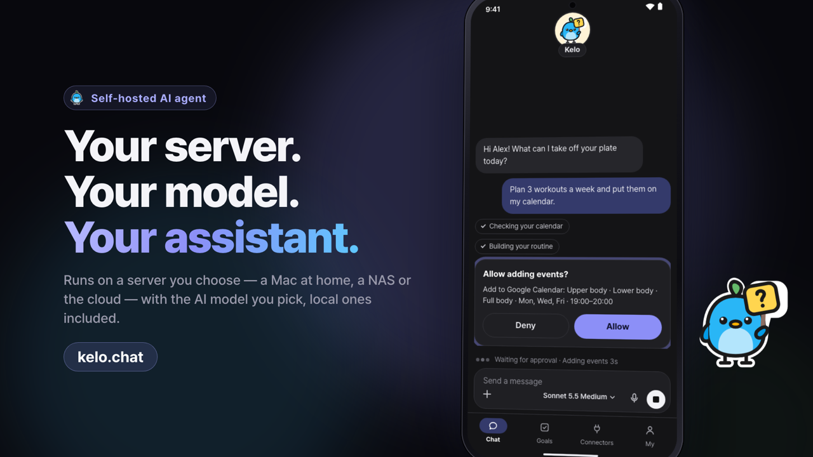
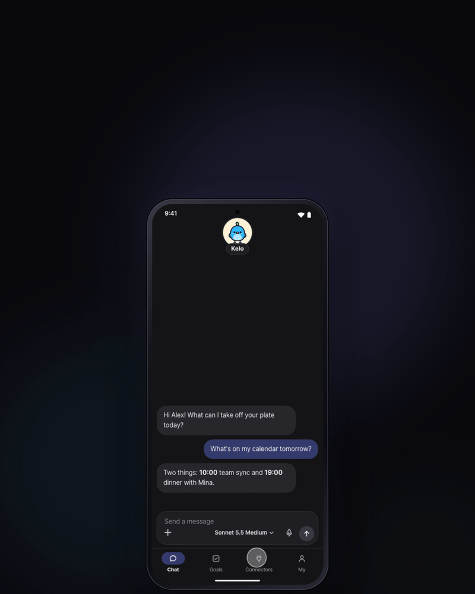
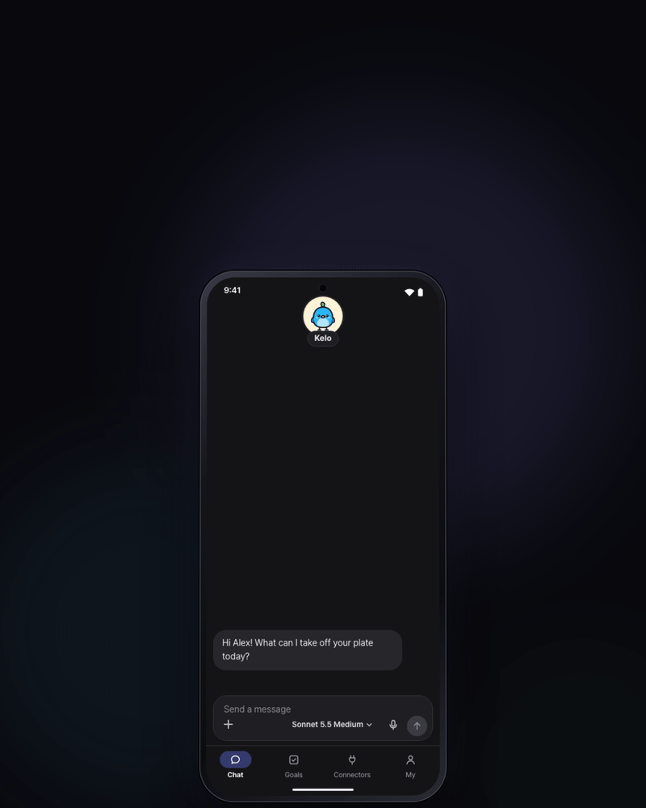
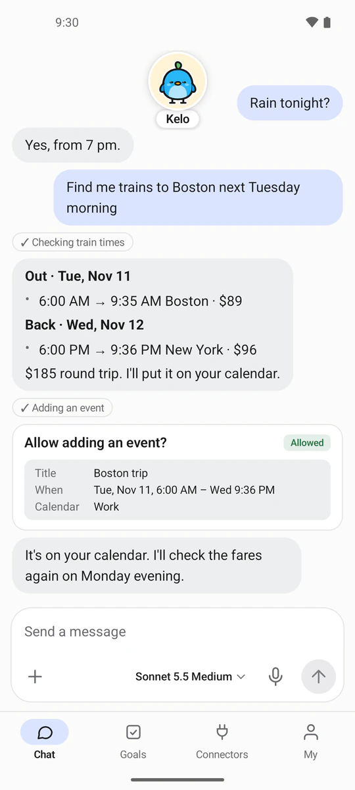
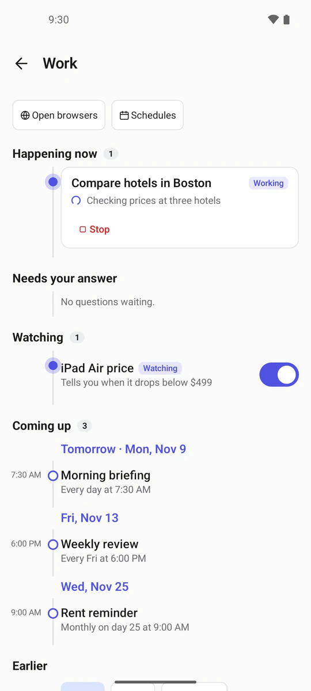
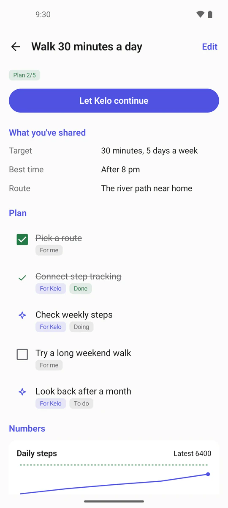
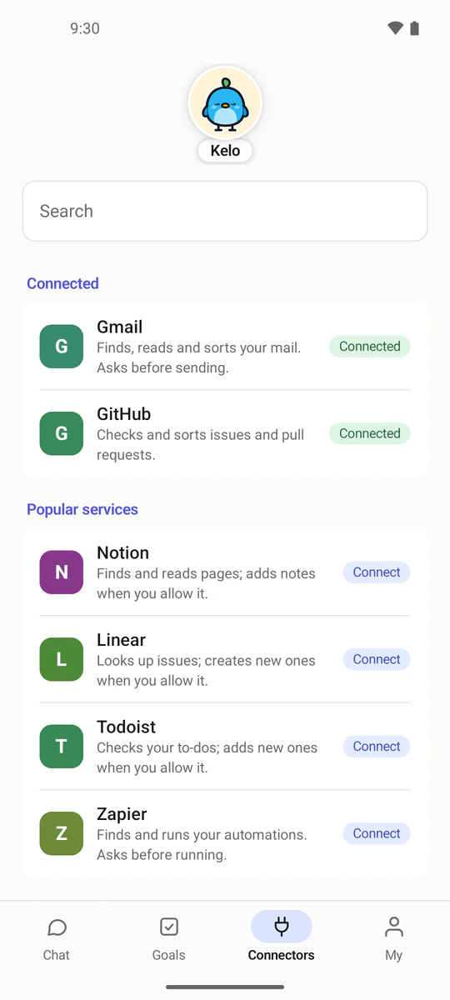

<p align="center"></p>

<p align="center">
  <b>A personal AI assistant that runs on a server you choose, with the AI model you choose — local models included.</b><br>
  You talk to it from your phone. It does the work in its own browser and the services you connect, and it asks before anything hard to undo.
</p>

<p align="center">
  <a href="https://kelo.chat">kelo.chat</a> ·
  <a href="https://kelo.chat/install">Install</a> ·
  <a href="README.ko.md">한국어</a>
</p>

---

## Why Kelo

**Your server, where you want it.** The Kelo server runs on a Mac at home, a Linux box, a mini PC or NAS with Docker, or a cloud
server. Chats, memory, files and keys stay on that server. The phone app is the remote.

**Any model you want — even a local one.** Pick from about 30 AI providers (Claude, GPT, Gemini, DeepSeek, Qwen, Mistral, Grok,
OpenRouter and more), or run a model on your own hardware with LM Studio, Ollama or any OpenAI-compatible server. With a local
model, your conversation never leaves your hardware. A fallback model from a different provider takes over when the main one fails.

**It asks first.** Looking things up just happens. Anything that commits something for you — paying, ordering, booking, sending,
deleting, changing an account — waits for your OK on the phone. When a site wants to check that you're a person, Kelo hands the
browser to you instead of trying to get around it.

<p align="center">
  
  
</p>

## What it does

- **Chat from your phone** — text or voice, photos and documents (PDF, Word, Excel), or share from any app with "Send to Kelo".
- **Its own browser** — opens sites, reads and compares, fills forms and signs in with logins you saved. Watch it live, take over,
  and hand it back.
- **Quick look-ups without a browser** — web search and page reading for prices, comparisons and facts, right in the chat.
- **Background work** — long jobs keep going with every step shown; questions they need come to the chat as cards.
- **Schedules and watchers** — run things at set times; get told when a page shows certain words or a number crosses your limit.
- **Goals** — write down a goal; Kelo keeps the plan, steps, numbers and due dates with you.
- **Connectors** — Gmail and other mailboxes, calendars, GitHub, Notion, Linear, Todoist and many more, each connected on the
  service's own sign-in page.
- **Keychain and cards** — passwords and keys go in through a form, never the chat, and the agent never sees them. Cards can be
  locked with a key only your phone holds.
- **Notifications** — when a task finishes or needs your OK. Pushes carry no content; the app fetches it from your own server.
- **20 languages** in the apps; Kelo answers in the language you write in.

<p align="center"></p>

## Apps

| Platform | Status |
|---|---|
| Android | Native app (Kotlin + Jetpack Compose). Sideload APK now; Google Play coming. |
| Windows / macOS desktop | Native app (Compose Multiplatform): chat, approvals, live browser, tray, notifications. |
| iOS | Native app (SwiftUI), in progress. |

<p align="center">
  
  
  
  
</p>
<p align="center"><sub>The "Walk 30 minutes a day" goal reads step counts from Health Connect. Step tracking is in the sideload APK only; the Google Play version does not support it yet.</sub></p>

## Install the server

**Needs:** Docker (Docker Desktop on macOS/Windows, Docker Engine on Linux).

| | RAM | CPU | Free disk |
|---|---|---|---|
| Minimum | 2 GB | 2 cores | 10 GB |
| Recommended | 4 GB | 4 cores | 20 GB |

The one-line installer opens when Kelo is published:

```bash
# macOS and Linux
curl -fsSL https://kelo.chat/install.sh | bash
```

```powershell
# Windows (PowerShell, Docker Desktop with WSL 2)
irm https://kelo.chat/install.ps1 | iex
```

The source code will be published here together with the installer.

The installer checks Docker, copies Kelo, and opens a four-step guided setup: check the server, pick a size, start Kelo, connect
your phone with a QR code. The AI model is chosen in the app afterwards. Full guide: [kelo.chat/install](https://kelo.chat/install).

### Reaching your server from the phone

- **Default address** — a free `https://<name>.kelo.chat` address (`kelo connect kelo --name <name>`).
- **Tailscale** — private, no public address.
- **Your own domain** — DuckDNS or any domain you own.


### Useful commands

```bash
kelo status            # each copy: running or not, its address
kelo phone add         # sign another phone in (QR code)
kelo limits --choose   # how much RAM/CPU/storage Kelo may use
kelo instance create alex   # another person on the same server, with their own data and keys
```

## How it's built

- **Server** — Python (FastAPI) in Docker, with a sandboxed Chromium browser, an egress proxy that refuses private addresses, and a
  separate work room for running code. One SQLite database per copy; secrets are encrypted at rest.
- **Apps** — native on every platform: Kotlin + Compose (Android, desktop), SwiftUI (iOS). No web views.
- **Models** — Anthropic, OpenAI, Google, OpenRouter, Bedrock, Vertex, Azure, DeepSeek, Mistral, xAI, Groq, Together, LM Studio,
  any OpenAI-compatible server, and more.


## Privacy

Your data lives on the server you run. The model provider you choose receives what it needs to answer. The kelo.chat operator
runs only optional relays (sign-in, push, the default address) and never has access to your server.
Policy: [kelo.chat/privacy](https://kelo.chat/privacy).

## License

Kelo is free software under the [GNU Affero General Public License v3.0 or later](https://www.gnu.org/licenses/agpl-3.0.html). If you run a modified Kelo server
for other people, the AGPL asks you to offer them your source. The Kelo name, logo and mascot are not covered by the licence —
forks need their own.

Questions: support@kelo.chat
